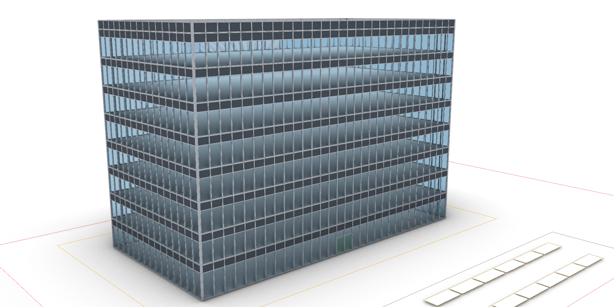
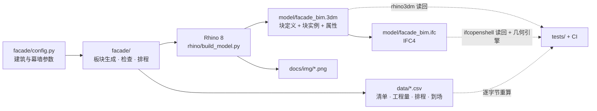
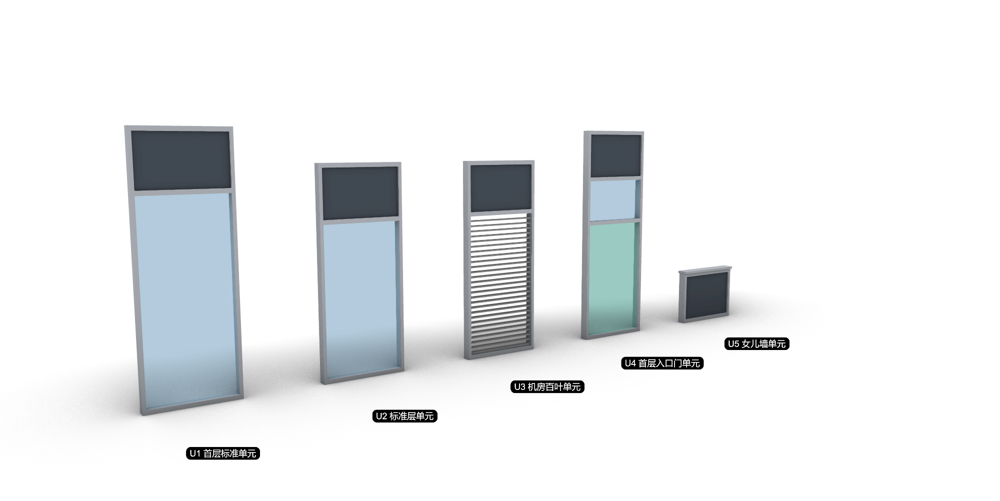
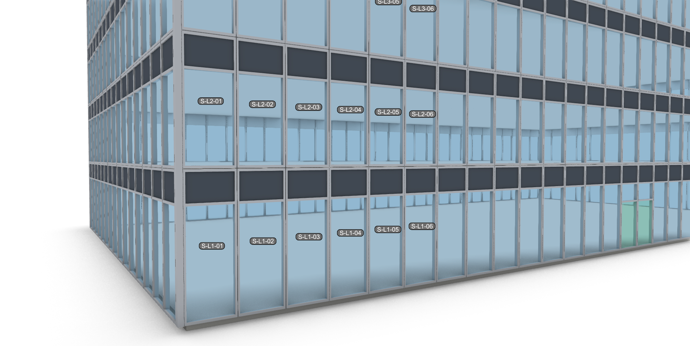
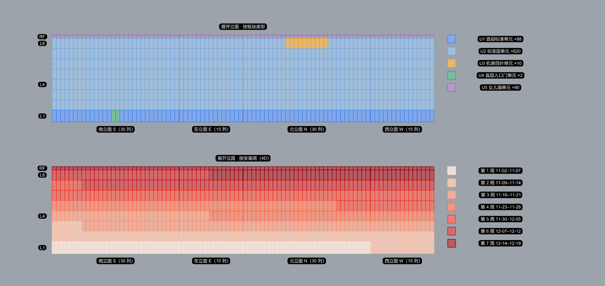
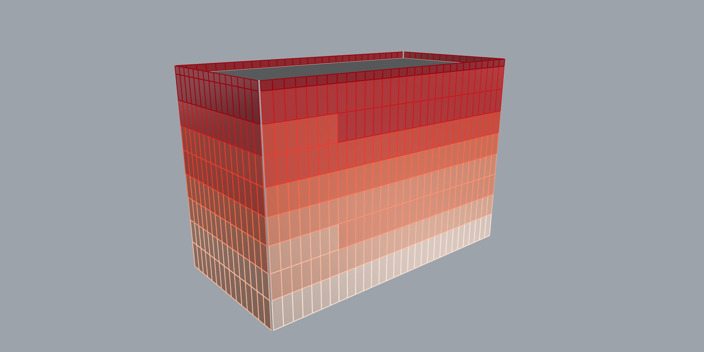
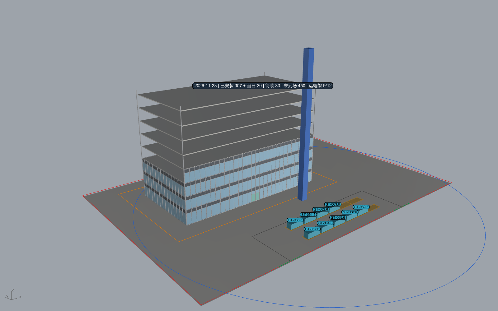
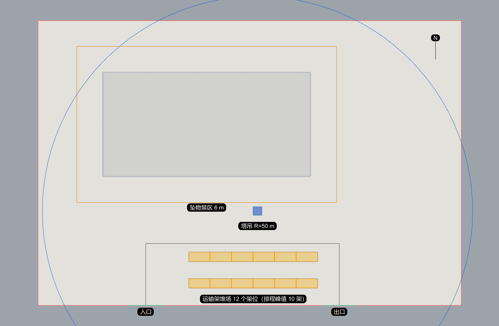

# facade-bim · 单元式幕墙 BIM

[](https://github.com/LUOaini1213/facade-bim/actions/workflows/ci.yml)

**A unitized curtain-wall BIM model built in Rhino 8 with RhinoCommon Python.** 810 panels on a fictional
8-storey office block; five panel types are Rhino block definitions and every panel instance carries 26
attributes. The same model drives design-rule checks, quantity take-off, a 4D install schedule, stillage /
truck / laydown logistics and a site plan, and exports to IFC4 that is schema-valid and byte-reproducible.
CI re-derives the default 24 mm reference figures from the committed `.3dm`, IFC and CSV files; offline verification needs no Rhino.

**Limits.** The building is fictional; every non-physical parameter (profile weights, labour rates, stillage, truck and laydown
limits) is an assumption marked in `facade/config.py`. It is a model-level design, not shop drawings (no sealant, corner caps or
waterproofing details), and rebuilding the Rhino model needs licensed Rhino 8 on Windows.



## 一眼看懂

- **810** 块单元板块、**5** 种类型（Rhino 块定义）、每块板挂 **26** 项属性（Rhino UserText）
- 模型检查 7 条 + 工地布置检查 5 条，**12/12** 通过；每条检查都有一个故意弄坏的反例证明它会失败（测试从 `checks.ALL` 与 `site.run_checks` 枚举全部检查逐条核对）
- 4D：**2026-11-02** 开装，**42** 个工作日装完；**140** 个运输架、**47** 车；堆场峰值 **10** 架
- IFC4：**810** 个 IfcPlate，schema 校验（含 EXPRESS WHERE 规则）**0** 问题；交给几何引擎算出实体后逐块比对，位置与模型偏差小于 0.01 mm
- 局限：建筑是虚构的，非物理常数参数（型材线密度、工效、每架板数、车辆与堆场限制）集中在
  [`facade/config.py`](facade/config.py) 并逐项标【假设】；这是模型级设计，不是施工详图
- 下文数字是 24 mm 默认交付示例，由 `scripts/check_readme.py` 对着已提交的产物回算，CI 每次提交都跑

## 一个模型，六份产物



IFC 是从 `.3dm` 里读出来的（块实例的变换给位置，实例属性给数据），不是从参数另算一遍——
所以它证明的是「Rhino 里建的这个模型能交付成开放格式」。

## 模型



| 类型 | 名称 | 数量 | 制作尺寸（mm） | 吊装重（kg） |
|---|---|---|---|---|
| U1 | 首层标准单元 | 88 | 1580 × 4480 | 233.1 |
| U2 | 标准层单元 | 620 | 1580 × 3880 | 201.8 |
| U3 | 机房百叶单元 | 10 | 1580 × 3880 | 129.8 |
| U4 | 首层入口门单元 | 2 | 1580 × 4480 | 258.7 |
| U5 | 女儿墙单元 | 90 | 1580 × 1180 | 63.1 |

外轮廓 48,360 × 24,360 mm，南北立面各 30 列、东西立面各 15 列，模数 1,600 mm、接缝 20 mm，
L1 层高 4,500、L2–L8 层高 3,900、屋面女儿墙 1,200。每块板由竖框、横框、可视中空玻璃、
层间釉面玻璃 + 岩棉 + 铝背板组成（百叶单元把可视区换成铝百叶，门单元多一道门扇）。
Rhino 里 5 种板块是 5 个块定义，810 块板是 810 个块实例，实例名即板块编号；
整个文件 **4,244** 个对象、**26** 个图层。

U5 压顶总宽 250 mm，背边对齐 180 mm 框深，外侧出挑 70 mm。
`COPING_END_JOINT` 配置相邻压顶总端缝，默认 **24 mm**：从分格中心两端各退让 **12 mm**，制造净长 **1576 mm**。
实际模型中相邻压顶净距 **24 mm**、压顶到角柱 **12 mm**、四角两压顶约 **16.970563 mm**；无需额外收口盒就能通过 10 mm 模型筛查。
24 mm 是虚构示例的可调建模假设，**不是工程推荐值**；没有建模密封胶、角部盖板或防水节点，也不代表施工详图已完成。
模型中 50 mm 高的压顶实体表示构造范围；真实铝板用量按 1576 × 250 × 3 mm 及材料密度计算，为 **3.1914 kg/块、287.226 kg/90块**。
原用量误按板块制作宽 1580 mm 计量，本轮同步纠正为真实净长；90块压顶铝总量减少 **0.729 kg**。
板块吊装重显示到 0.1 kg，因此 U5 表中仍为 63.1 kg。定点修补只更换一个共享压顶实体和相关用量属性，全部原板块、定义及零件 GUID、其余原属性和变换均保留。



## 模型检查

规则直接在生成出的几何上量，不信任「按构造应当成立」：接缝是逐对相邻板块量出来的，
冲突是同层板块的平面包络矩形两两求交（实体布尔求交在下文 Rhino 三维质量检查里）。

| 检查 | 结果 | 实测 |
|---|---|---|
| 板块编号唯一 | ✅ | 810 个编号，重复 0 |
| 竖缝宽度 = 20 mm（逐对量） | ✅ | 量了 846 处，偏差 0 处 [] |
| 横缝宽度 = 20 mm（逐对量） | ✅ | 量了 720 处，偏差 0 处 |
| 板块与板块、板块与转角立柱无冲突 | ✅ | 逐对检查 39285 对，冲突 0 |
| 板块位于外轮廓 48360×24360 mm 内 | ✅ | 越界 0 块 |
| 单片玻璃 ≤ 2440×4200 mm | ✅ | 超限 0 片；最接近上限：S-L1-01 vision1 1460×3340，利用率 80% |
| 吊装重 ≤ 小吊机额定 400 kg | ✅ | 超限 0 块；最重 S-L1-15 258.7 kg，利用率 65% |
| 塔吊覆盖整栋楼（半径 50 m） | ✅ | 最远楼角 48.4 m |
| 塔吊覆盖全部架位 | ✅ | 最远架位角 24.1 m |
| 堆场架位 ≥ 排程峰值 | ✅ | 布置图 12 个架位，排程峰值 10 架 |
| 堆场不进坠物禁区（楼外 6 m） | ✅ | 堆场北边 y=-17.6 m，禁区南边 y=-6.0 m |
| 堆场、塔吊、车道都在红线内 | ✅ | 红线 98.4×66.4 m |

`tests/test_model.py` 给每条模型检查配了反例：把一块板挪 5 mm，竖缝或横缝检查必须变红；
让两块板重叠 40 mm，冲突检查必须变红；把塔吊臂长改成 45 m，覆盖检查必须变红。
其余几条同样各有反例（板块挪出外轮廓、堆场挪出塔吊半径或挪进坠物禁区、塔吊/堆场/车道越出红线、
排程峰值超过架位）；`EveryCheckHasACounterexample` 从 `checks.ALL` 与 `site.run_checks` 枚举全部检查，
新增检查没配反例或反例不再让它变红，测试即失败。

## 工程量

| 类型 | 数量 | 立面面积 m² | 可视中空玻璃 m² | 层间 m² | 百叶 m² | 门扇玻璃 m² | 型材铝 kg | 背板铝 kg | 压顶铝 kg | 支座 | 板块重 t |
|---|---|---|---|---|---|---|---|---|---|---|---|
| U1 | 88 | 633.60 | 429.12 | 115.63 | 0.00 | 0.00 | 4390.85 | 936.62 | 0.00 | 176 | 20.51 |
| U2 | 620 | 3868.80 | 2480.25 | 814.68 | 0.00 | 0.00 | 27810.72 | 6598.91 | 0.00 | 1240 | 125.12 |
| U3 | 10 | 62.40 | 0.00 | 13.14 | 40.00 | 0.00 | 448.56 | 106.43 | 0.00 | 20 | 1.30 |
| U4 | 2 | 14.40 | 2.51 | 2.63 | 0.00 | 7.01 | 107.97 | 21.29 | 0.00 | 4 | 0.52 |
| U5 | 90 | 172.80 | 0.00 | 134.03 | 0.00 | 0.00 | 1627.92 | 1085.63 | 287.23 | 180 | 5.68 |
| 合计 | 810 | 4752.00 | 2911.88 | 1080.11 | 40.00 | 7.01 | 34386.02 | 8748.87 | 287.23 | 1620 | 153.12 |

立面面积有一道独立的对账：板块模数面积之和 = 外立面周长（不含转角立柱）× 总高，
即 144 m × 33 m = 4,752 m²。

## 4D 安装排程



两个班组、每班每日 8 小时，逐层、每层按南 → 东 → 北 → 西绕楼一圈安装，一块板不跨日拆分。
`install_plan` 只在参数为 `None` 时使用默认值。班组数必须是正整数，每班有效工时和单板安装工时必须是有限正数；
单板工时超过一天的合计班组工时会明确拒绝，不会挪到下一天假装可安装。这仍是合计工时模型，未表示各班组独立资源或抢占作业。
**2026-11-02** 开装，**2026-12-19** 装完，共 **42** 个工作日。展开立面下条的阶梯状周界线就是这条顺序：
一周装不完一层，周界线落在半层——第 1 周装了 **75** 块、止于 N-L1-30，首层西立面整面落进第 2 周。



## 到场与堆场

### Rhino 按日施工回放

推荐在 Rhino 8 打开 `model/facade_bim.3dm`，运行 `rhino/timeline.py`：
非模态时间轴支持日期滑块、前后一天、播放/暂停、日期跳转、板块编号或当前选择查询，以及导出当前阶段。
面板打开时可以继续旋转、选择和操作 Rhino；到最后一天自动停止，关闭面板也会停止定时器。
日期来自模型自身的到场与安装属性，查询会显示原 BIM 数据及当前施工状态；未安装板块保持隐藏。

在 Rhino 8 中打开 `model/facade_bim.3dm`，用 `RunPythonScript` 选择
`rhino/replay_install.py`。输入任意 `YYYY-MM-DD`，或用 `Next` / `Previous`
逐日查看；`Save` 导出当前日期的独立 `.3dm`、PNG 和 JSON，`Done` 结束。

回放直接读取每个块实例的到场日、安装日和运输架编号，分成「未到场、堆场待装、
当日安装、已安装」四种状态。待装板不会提前出现在建筑上；当日安装板以橙色标出，
已装板显示原构件。运输架按到场与装空日期分配到总平面的 12 个架位，重复利用空架位；
架位不足或模型日期属性不一致会报错。架子是标有编号和剩余板数的占位示意体。

批量生成开工前、开工日、施工中和完成后的阶段模型：

```bash
python scripts/run_replay.py
python scripts/run_replay.py --dates 2026-11-02 2026-11-23 2026-12-20
python scripts/check_replay.py  # 无需 Rhino，独立读回所有日期模型并核对实际显隐及架位
```

产物写到 `model/replay/facade_日期.{3dm,png,json}`；原始交付模型可继续用于 IFC 导出。
统计口径是「当日施工期间」：当日安装的板块已显示，装空的架子当日仍占位、次日释放，
与既有堆场占用表一致。楼板、转角立柱与施工设施作为静态参照；此功能是离散日期回放。





沿安装顺序把连续的同类型板块装进运输架（每架 2–10 块，按类型），共 **140** 个架子；
每个架子最迟在首块板安装前 1 个工作日到场，连续 3 个架子拼一车，共 **47** 车，
每日卸车超过 2 车就往前挪（倒排，尽量准时）。首车 **2026-10-31** 到场，堆场峰值 **10** 架（**2026-12-12**），
没有一个架子晚于最迟到场日；拼车让 **41** 个架子比最迟日早到。

堆场按 2 排 × 6 列画了 **12** 个架位——这是布置图的输入，不是按排程反推的，排程要装得进去才算通过。
改两个物流参数重跑：

| 每日卸车上限 | 提前到场（工作日） | 堆场峰值（架） | 比最迟日早到的架子 | 首车到场 | 装得进 12 个架位 |
|---|---|---|---|---|---|
| 1 | 1 | 21 | 124 | 2026-10-26 | 否 |
| 1 | 2 | 24 | 124 | 2026-10-24 | 否 |
| 1 | 3 | 27 | 124 | 2026-10-23 | 否 |
| 2 | 1 | 10 | 41 | 2026-10-31 | 是 |
| 2 | 2 | 14 | 41 | 2026-10-30 | 否 |
| 2 | 3 | 17 | 41 | 2026-10-29 | 否 |
| 3 | 1 | 10 | 41 | 2026-10-31 | 是 |
| 3 | 2 | 14 | 41 | 2026-10-30 | 否 |
| 3 | 3 | 17 | 41 | 2026-10-29 | 否 |

两条读法：大门每天只能卸 1 车时，拼车会把大批架子提前送到，堆场峰值翻倍；
而卸车上限放到 3 车没有任何变化——2 车以上大门就不是瓶颈，瓶颈变成堆场本身：
12 个架位只容得下「提前 1 个工作日到场」，提前 2 天峰值就到 14 架。

## IFC4 交付

`model/facade_bim.ifc` 由 [`scripts/export_ifc.py`](scripts/export_ifc.py) 从 `.3dm` 导出：

- IfcProject → IfcSite → IfcBuilding → **9** 个 IfcBuildingStorey
- 每层每个立面一个 IfcCurtainWall，共 **36** 个，聚合该段的 IfcPlate，共 **810** 个
- **5** 个 IfcPlateType 对应 Rhino 的 5 个块定义，类型 RepresentationMap 保存真实零件几何；
  **7,464** 个 IfcBuildingElementPart 对应模型中的框、玻璃、岩棉、背板和百叶等实际 Brep。
  每个父板聚合自己的子件，实体 Body 和材料存于子件，避免父子重复几何；共享几何按块定义零件复用。
  中空玻璃按 Rhino 中的单实体导出，不拆成模型中不存在的玻璃与空气层
- **4** 根转角立柱为 IfcMember，**9** 块楼板为 IfcSlab
- 每块板挂 Pset_PlateCommon、自定义的 FacadeBIM_Panel（编号、层、列、安装序号与日期、架号、车号、到场日）
  和 Qto_PlateBaseQuantities（面积、周长、重量）

- **7** 种 IfcMaterial 关联真实分件与结构；FacadeBIM_Part 保留父板编号、零件序号、零件类、Rhino 身份和材料名
  并区分 `ROOF_COPING` / `RHINO_BLOCK_PART` 角色，以及 `CONSTRUCTION_ENVELOPE` / `SOURCE_GEOMETRY` 表示用途。
  **90** 个压顶分件另有 FacadeBIM_Coping：真实板厚 **3 mm**、制造长度 **1576 mm**、制造宽度 **250 mm**、
  未四舍五入质量 **3.1914 kg**，同时明确 Body 的 **50 mm** 高度是构造包络。
  密度和板厚取绑定当前 `.3dm` SHA 的 `model/source_config.json` 示例输入；长度、宽度取真实源几何。
  属性名的 `MM` / `KG` / `KGPerM3` 后缀声明单位，`FLAT_SHEET_NOT_ENVELOPE_VOLUME` 说明质量按平板估算，
  这些输入不是实测或获批加工资料。IDS 检查必需字段与正数，独立检查器重算全部压顶数值，拒绝把代理实体体积当板材质量。
- **950** 个 IfcTask（**810** 个安装、**140** 个交付），每个任务带 IfcTaskTime，归入正式 IfcWorkSchedule，
  并以产品输出关系关联板块。日期来自源模型 UserText，任务日窗为 `[00:00, 次日00:00)`，
  `P1D` 表示日期分辨率，不是实际工时。FacadeBIM_RhinoUserText 逐字段保存全部原始字符串

文件共 **190,709** 个实体，ifcopenshell 的 schema 校验（含 EXPRESS WHERE 规则）**0** 个问题。GlobalId 由编号经 uuid5 推出、
文件头时间戳固定、SET 属性按实体序号排序，同一个 `.3dm` 每次导出逐字节相同，CI 直接比对字节。

## 三维质量与信息交付检查

`rhino/quality_check.py` 在 Rhino 里对每个板块的实际块定义 Brep 做闭合实体布尔求交（碰撞），
并用 `MeshClash` 在三角网格上筛净距（默认阈值 10 mm）；`scripts/check_ids.py` 按 IDS 1.0 检查信息交付。
当前完整源模型 **0 条体积穿透、0 条净距不足、0 条接触、0 条距离待核、0 条内核未决**，`clearance_ok=true`。
仍保留 **72 条10 mm阈值边界**（L1–L8端框与角柱64条、屋顶端框与角柱8条），不算不足；无相邻楼层事件。
这些是模型几何判断，不是现场实测或施工公差验收。分类口径、独立检查器、反例和时间轴检查见
[docs/QUALITY.md](docs/QUALITY.md)。

```bash
python scripts/run_quality.py                         # 原生 Rhino：几何 + 实际 Eto 控件/定时器事件
python scripts/check_quality.py                       # 无需 Rhino，独立核对报告与源模型身份/完整范围
python scripts/check_ids.py                           # IDS 1.0 规则 + JSON/HTML 信息交付报告
```

## 怎么核、怎么复跑

需要 Python 3.11（CI 与交付索引用的版本；`facade/` 核心另保持 3.9 兼容）。

60 秒快速核对（只用标准库，不装依赖也能跑，本机约 1 秒）：

```bash
python -m unittest tests.test_model tests.test_schedule tests.test_replay   # 12 条检查及其反例、排程不变量
python scripts/build_data.py --check                                        # data/ 与重算结果逐字节一致
```

完整离线核对，不需要 Rhino（CI 跑的就是这几条；完整 pytest 在 Windows 笔记本上约 7–8 分钟）：

```bash
pip install -r requirements.txt
python -m pytest tests                  # 模型检查、排程约束、.3dm ↔ CSV ↔ IFC 对账
python scripts/export_ifc.py --check    # 由 .3dm 重导的 IFC 与已提交文件逐字节一致
python scripts/check_readme.py          # 本文每个数字对着产物回算（含一次约 1 分钟的 EXPRESS 规则校验）
python scripts/check_ids.py --no-write-reports   # IDS 规则与材料/字段/任务交付要求
python scripts/check_ifc.py             # 独立核对实际 Rhino 零件、材料、任务时间和关系
python scripts/check_replay.py          # 独立读取原生日期模型
python scripts/check_quality.py model/quality/native_all.json --no-write-reports   # 核对原生几何及时间轴报告
```

重建 Rhino 模型与截图需要 Rhino 8（Windows）。各启动脚本默认找
`C:\Program Files\Rhino 8\System\Rhino.exe`，装在别处时先设环境变量 `RHINO_EXE` 指向 `Rhino.exe`：

```bash
python scripts/run_rhino.py             # 调起 Rhino 跑 rhino/build_model.py，存 .3dm 与 docs/img/
python scripts/export_ifc.py            # 重导 IFC
python scripts/build_data.py            # 重算 data/
```

已有模型可用 `python scripts/run_roof_repair.py --end-joints` 按配置原生修补压顶端缝和真实铝板用量，不重建板块身份；
只有 `COPING_END_JOINT` 可以在已有源上修补，更改其它输入会在任何模型写入前失败，需要明确重建源模型。
前置检查、备份与读回流程见 [docs/DELIVERY.md](docs/DELIVERY.md)。

## 默认参考交付与自定义端缝

README 数字展示 24 mm 默认交付示例，包括几何、工程量、IFC 和质量结果。
自定义 `COPING_END_JOINT` 的实际结果见 `model/profile_summary.json`；摘要绑定当前源 SHA，
记录真实跨度、未舍入板材质量、三类模型净距和完整质量计数。
`python scripts/check_profile.py --write` 在原生质量检查及 IFC/数据导出后生成摘要，
`python scripts/check_profile.py --check` 只读回算源几何、IFC、CSV 和完整原生事件集合。
默认 24 mm 仍核对 README 的全部数字；自定义端缝核对实际 profile，明确不会声称本文参考数字等于当前产物。
已有源只允许单改压顶端缝，其它输入须明确重建源模型。

## 完整交付入口

```powershell
.\.venv\Scripts\python.exe scripts\delivery.py --check        # 离线核对交付索引 + 全部独立检查，不启动 Rhino
.\.venv\Scripts\python.exe scripts\delivery.py --revalidate   # 只改代码、正式产物不变时：只读复算后追加验证快照
.\.venv\Scripts\python.exe scripts\delivery.py --rebuild      # 有许可证的 Windows Rhino 中原生重建
```

`model/delivery_index.json` 绑定代码、配置、源模型与全部正式产物的指纹；各模式的细节见 [docs/DELIVERY.md](docs/DELIVERY.md)，
本次安装容量修复及独立只读核验的范围见 [验证说明](docs/INSTALL_CAPACITY_REVIEW.md)。

## 仓库结构

| 路径 | 内容 |
|---|---|
| `facade/config.py` | 全部参数；几何、物理常数、假设值分开标注 |
| `facade/model.py` | 板块生成：编号、类型、定位、分区、工程量、吊装重 |
| `facade/checks.py` | 7 条模型检查 |
| `facade/schedule.py` | 4D 安装排程、运输架装箱、到场倒排、堆场占用 |
| `facade/site.py` | 施工总平面几何与 5 条布置检查 |
| `facade/pipeline.py` | 把以上算成表，Rhino 脚本、IFC 导出、测试共用 |
| `facade/replay.py` | 施工日期状态：只读模型里的安装/到场属性，不另算排程 |
| `facade/source_integrity.py` | 把源模型绑定到输入配置；已有源只允许修补压顶端缝 |
| `rhino/build_model.py` | Rhino 8 脚本：块定义、块实例与属性、楼板、转角立柱、分析图层、总平面、出图、存盘 |
| `rhino/timeline.py` | Rhino 8 非模态施工时间轴 |
| `rhino/replay_install.py` | Rhino 8 原生按日回放；`run_replay.py` 批量出图 |
| `rhino/quality_check.py` | 原生三维质量与 Eto 时间轴事件检查（不存回源模型） |
| `rhino/spatial_quality.py` | 闭合 Brep 布尔体积 + 三角网格净距筛查 |
| `rhino/probe_spatial.py` | Rhino API 探针，输出 `model/quality/spatial_probe.json` |
| `rhino/repair_coping_joints.py` | 按配置修补 U5 压顶端缝，保留全部源 GUID |
| `rhino/repair_roof_coping.py` | 原位平移共享 U5 压顶，保留全部源 GUID |
| `scripts/run_rhino.py` | 用 `Rhino.exe /runscript` 无人值守地跑 `rhino/build_model.py` |
| `scripts/run_replay.py` | 批量调用 Rhino 输出日期 `.3dm` / PNG / JSON |
| `scripts/run_quality.py` | 批量调用 Rhino 跑碰撞、净距和时间轴检查 |
| `scripts/run_roof_repair.py` | 在 Rhino 中运行保留 GUID 的压顶修补 |
| `scripts/export_ifc.py` | `.3dm` → IFC4；`--check` 比对字节 |
| `scripts/build_data.py` | 重算 `data/`；`--check` 比对字节 |
| `scripts/check_readme.py` | README 数字回算 |
| `scripts/check_ifc.py` | 独立核对 IFC 的真实零件、材料、定位与任务 |
| `scripts/check_ids.py` | IDS 1.0 信息交付检查与报告 |
| `scripts/check_quality.py` | 独立读回原生质量报告 |
| `scripts/check_replay.py` | 独立读回日期回放模型 |
| `scripts/check_profile.py` | 生成或核对端缝 profile 摘要 |
| `scripts/delivery.py` | 交付索引：`--check` / `--revalidate` / `--rebuild` |
| `quality/` | `delivery.ids` 信息交付规则与其配置 `profile.json` |
| `model/` | `facade_bim.3dm`、`facade_bim.ifc`、构建日志、交付索引；`quality/` 质量报告，`replay/` 日期回放快照 |
| `data/` | 板块清单、工程量、运输架、车次、逐日安装与堆场、敏感性、检查结果 |
| `docs/` | 图片、[质量检查细节](docs/QUALITY.md)、[交付索引细节](docs/DELIVERY.md)、安装容量核验说明 |
| `tests/` | 模型与检查（含反例）、排程不变量、产物对账；`tests/test_readme.py` 也核对本表覆盖全部脚本 |

`facade/` 只用标准库并保持 Python 3.9 兼容——Rhino 8 内置的 CPython 是 3.9，
Rhino 里的建模脚本和 CI 里的测试 import 的是同一份代码。

## 许可

MIT，见 [LICENSE](LICENSE)。
